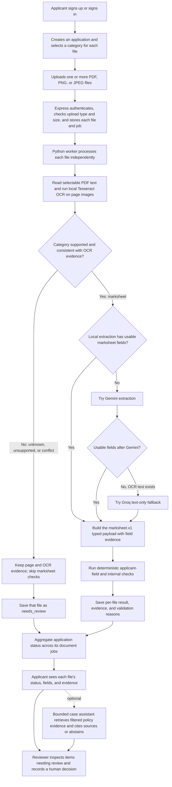

# DocFlow Agent

DocFlow Agent is currently a synthetic document-processing and human-review prototype. Marksheets are the only supported verification category. Birth certificates, identity cards, caste/category certificates, EWS certificates, fee receipts, nationality certificates, domicile certificates, income certificates, and unknown types can be categorized for upload, but currently retain OCR/page evidence and route to `needs_review` without type-specific checks. The React UI and Express application API stay in TypeScript; a Python agent service handles PDF processing, OCR, extraction, validation, and background jobs. The traffic simulator remains Node.js.

**Current status:** The applicant web flow, authenticated Express API, per-document Python processing worker, reviewer UI, and bounded case assistant are connected. V2 Stages B-F passed their recorded checks. Stage G's code and documentation checks pass; a clean-environment setup and owner review of release limits remain. The current verifier supports marksheets only. The recorded synthetic traffic run completed 100 of 100 submissions with 0 failures and 0 retries. Latest checks: Python 93 passed, API 5 passed, web 2 passed, simulator 8 passed, and API/web builds passed. These are synthetic checks, not claims of real-world accuracy. Use synthetic documents and policies only.

## Scope and decision safeguards

- Every new upload requires an explicit document type. The processing result keeps shared metadata/page evidence separate from its typed payload and per-file decision. A strong OCR title conflict, unknown type, or unsupported category routes to `needs_review`; the agent does not coerce it into `marksheet.v1`.
- Only marksheets are currently supported. Additional document categories need their own approved fields, deterministic validation rules, synthetic fixtures, and acceptance tests before implementation.
- Use synthetic applicant/document data only in repository development, testing, and evaluation. Do not upload or process real student/applicant records.
- Extracted values and rule checks show whether supplied information is present and consistent; they do not prove issuer authenticity or detect fraud. Do not show an authenticity score or automatically reject applicants.
- Keep consequential decisions with an authorized human reviewer and show evidence/reasons for review.
- Current scan fallback order is local Tesseract/extraction, then Gemini when local output is unusable, then Groq `openai/gpt-oss-20b` only when OCR text is available. Groq receives text only and cannot replace OCR. Keep its API use within the configured account's free tier.
- Deployment described by the roadmap is a synthetic demo only, not production approval.

## Upload-to-result flow

Each file keeps its own selected category, processing state, evidence, typed result, and validation outcome. The application status is aggregated only after all of its document jobs are considered.



The model fallbacks extract fields; deterministic checks produce the processing outcome, and a human reviewer retains the consequential decision. The optional case assistant is reviewer support: it can use policy retrieval but cannot approve a case. Unsupported categories retain evidence and require review; they are not mapped to the marksheet schema.

## Stack

- Web: React, Vite, TypeScript, Tailwind CSS
- Application API: Node.js, Express, TypeScript, PostgreSQL (configured through `DATABASE_URL`)
- Processing agent: Python 3.11+, FastAPI, Pydantic
- OCR and image preprocessing: Tesseract OCR, pytesseract, Pillow
- Name matching: RapidFuzz
- Optional structured extraction: Gemini API (`google-genai`); local labelled-field extraction is the default
- Text extraction fallback: Groq `openai/gpt-oss-20b` after OCR and Gemini only; Groq receives OCR text, never image bytes, and requires the owner's free-tier account/key
- Evaluation and tests: Python, pytest

## Local setup

The Express API and React app are separate TypeScript services connected to the Python processing worker through queued jobs and the shared PostgreSQL database.

```powershell
# Install Python agent and synthetic PDF generator dependencies
python -m venv .venv
.\.venv\Scripts\Activate.ps1
python -m pip install -r services/agent/requirements.txt
python -m pip install -r eval/pdf/requirements.txt

# Generate synthetic PDFs (ignored by Git)
python eval/pdf/generate_pdfs.py --seed 2027

# Start the Python agent from the repository root
python -m uvicorn services.agent.app.main:app --host 127.0.0.1 --port 4100
```

The agent exposes `GET /health`, `POST /extract`, and `POST /process` at `http://127.0.0.1:4100` (interactive docs: `/docs`). PDF uploads are limited to 2 MB and 5 pages. Text pages return selectable text; image-only pages return PNG page data. `/process` accepts a PDF, PNG, or JPEG plus explicit `application` and `document_type` form fields; its response includes page count, OCR evidence references, per-field provenance, a versioned type-specific payload when supported, deterministic validation evidence, decision, and timings. PDFs are limited to 5 pages; all uploads are limited to 2 MB and images to 4 million pixels. Uploads are processed in memory and are not persisted.

**Synthetic/local use only:** `/process` is not authenticated. Bind the service to loopback as shown above and do not expose it to a network or submit real student records. Real-department use must wait for authenticated API integration and the later security/deployment phases. The default labelled-field extractor needs no API key. Tesseract must be installed separately; on Windows the agent auto-discovers `C:\Program Files\Tesseract-OCR\tesseract.exe`, otherwise make it available on `PATH`. Gemini is optional, requires `GEMINI_API_KEY`, and sends OCR text to Google's service, so keep it disabled for anything other than authorized synthetic data.

Copy `.env.example` to `.env` and set `DATABASE_URL` to the PostgreSQL connection string for your development database. Keep `.env` private. Start the API from `apps/api`:

```powershell
cd apps/api
npm install
npm run dev
```

The API listens on `127.0.0.1:4000` by default. It allows browser requests from the local Vite origins `http://localhost:5173` and `http://127.0.0.1:5173`; set `WEB_ORIGINS` to override them. `HOST` and `PORT` can also be overridden. To process queued uploads, start the worker from the repository root in another terminal:

```powershell
python -m services.agent.app.worker
```

The Express API and Python worker read the same `DATABASE_URL`. Uploads must include the selected category in the `X-Document-Type` header. The worker claims jobs using PostgreSQL row locks, retries processing failures up to three attempts, and stores per-document results, evidence references, validation flags, and audit events. The application status aggregates all its documents; one completed file cannot mark a still-processing case verified. Uploaded synthetic documents are stored under the ignored `uploads/` directory. Set a long random `DOCFLOW_INTERNAL_TOKEN` in `.env` for both the API and private FastAPI service. Express checks case ownership and user authentication before it calls `/internal/cases/run`; the processing route rejects requests without the matching service token. Promote reviewer accounts through the development database by setting `users.role='reviewer'`; new accounts default to applicant access.

The React status preview is in `apps/web`. It signs in to the Express API, lists the signed-in user's applications, and subscribes to each application's owner-authorized Server-Sent Events stream. The browser uses `fetch` streaming rather than native `EventSource` so the bearer token can stay in an `Authorization` header instead of the URL; the token is held in memory only. The API checks the latest job once per second and emits only changed status values; reconnects use capped exponential backoff and the browser has no polling fallback. The API URL defaults to `http://127.0.0.1:4000`; set `VITE_API_BASE_URL` in `apps/web/.env.local` if the API uses a different local address. Ensure the API's `WEB_ORIGINS` includes the browser origin.

Run the PDF service and Python tests:

```powershell
python -m pytest

# API and status dashboard
cd apps/api
npm test
npm run build
cd ../web
npm test
npm run build
```

Phase-specific evaluation output is written to the ignored `eval/results/` directory. Only report metrics emitted by an actual evaluation/simulator run.

## Phase 6 synthetic traffic simulator

Generate the synthetic PDF set with `python eval/pdf/generate_pdfs.py --seed 2027`. Start the Express API and Python worker against the same development database, then register a synthetic account. Keep its email and password in the ignored local `.env`; `.env.example` contains placeholders only. From the repository root, run:

```powershell
node --env-file=.env eval/simulator/run.js --count 100 --seed 2027 --rate-per-second 2
```

The simulator authenticates using `SIMULATOR_EMAIL` and `SIMULATOR_PASSWORD`, submits only generated marksheets, observes the application status stream, and writes raw per-document events/timings to the ignored `eval/results/realtime.csv`. It reports completion, timing, failure, retry, and answer-match summaries derived from that CSV. The fixed seed reproduces fixture selection; it does not fabricate run timings. Planted `board` and `result` mismatches are marked `not_evaluated` because the current deterministic validator does not compare those fields. These results are not authenticity checks, fraud detection, or a real-world accuracy rate.

For PNG fixtures, run with `--answer-key eval/data/answer_key.csv --documents-dir eval/data/images`; the default paths use the generated PDF set.

The simulator supports `--help` for all options. It refuses to replace an existing output CSV unless `--overwrite` is explicitly supplied. Its tests use a mocked API; the separate 100-document acceptance run requires a running API, worker, database, valid synthetic account, generated fixture files, and Tesseract for scanned PDFs.

## React status preview

Start the API and worker as described above, then start the web client:

```powershell
cd apps/web
npm install
npm run dev
```

The status page is a development preview for synthetic accounts and applications. Its status stream returns only application ID, status, and update time; it does not expose document contents or validation details.

## Current milestone and next work

Stage E connects the bounded case assistant to owner-scoped API requests and reviewer-visible persistent runs, findings, policy citations, and redacted tool traces. Stage F's local-only simulator output is saved at ignored `eval/results/realtime-stagef-20261022.csv`; Gemini/Groq were disabled for that run, so it measures local OCR/rules and API/worker flow. That recorded run completed 100/100 submissions with 0 failures and retries; 96 answer-match cases were evaluated and all 96 matched. Migration `006_agent_runs.sql` is applied to the development database. The latest regression checks passed: Python (93), API (5), web (2), simulator (8), and both TypeScript builds. Stage G's clean-environment setup and owner review remain. Phase 8 security/deployment work and category-by-category support beyond marksheets are still planned; this is not production approval.

See [docs/PLAN.md](docs/PLAN.md) and [docs/decisions.md](docs/decisions.md) for the architecture and decisions.
